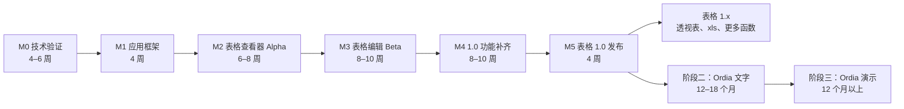
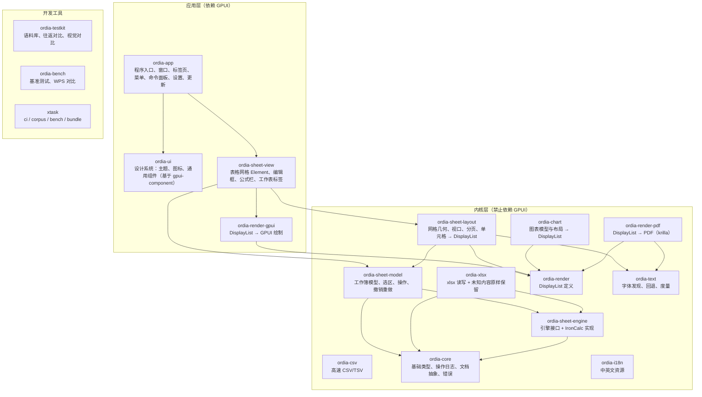
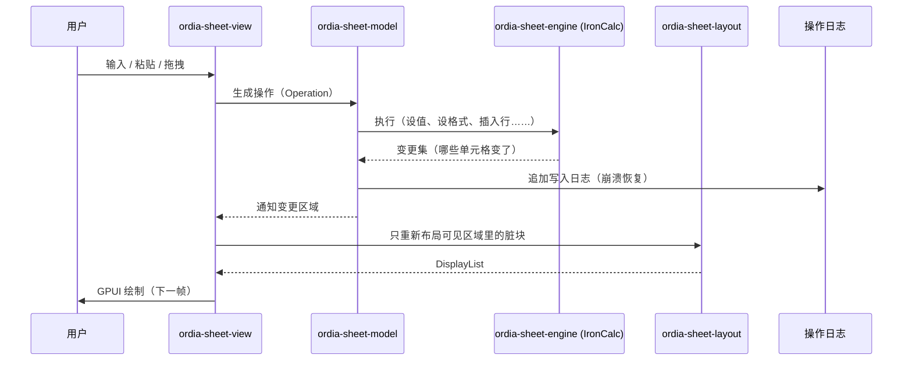
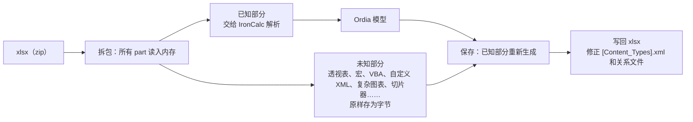
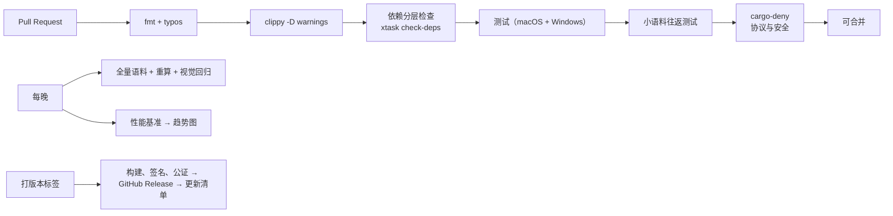

# Ordia 总体方案

> 一个基于 Rust + GPUI + GPUI Kit 的高性能、高颜值跨平台办公套件，目标是替代 Office 和 WPS。
>
> 关联文档：[决策记录 DECISIONS.md](./DECISIONS.md) · [任务清单 TASKS.md](./TASKS.md) · [Agent 规范 AGENTS.md](../AGENTS.md)

---

## 1. 愿景与定位

**一句话**：比 WPS 更快、比 Office 更轻、比两者都好看的开源办公套件。

| 项目 | 内容 |
|---|---|
| 目标用户 | 个人用户与专业人士（学生、白领、自由职业者） |
| 核心价值 | ① 快：秒开、滚动不卡、低内存 ② 好看：现代、克制、有质感 ③ 放心：打开别人的 Excel/WPS 文件不乱，保存不丢东西 ④ 干净：无广告、无强制登录、不收集数据、开源 |
| 第一个产品 | **Ordia 表格**（对标 Excel / WPS 表格） |
| 后续 | Ordia 文字（对标 Word）→ Ordia 演示（对标 PowerPoint） |
| 平台 | 第一阶段：macOS + Windows；远期：Linux、Web、移动端 |
| 协议 | Apache-2.0 开源，个人免费，前 1–2 年不商业化 |

### 1.1 不做什么（至少在 1.0 之前）

- 不做云服务、账号体系、实时协同（D-008）
- 不执行 VBA 宏，只保留宏内容不破坏（D-017 P3）
- 不追求 Office 的全部功能，只追求**个人用户 95% 的日常场景**
- 不做 Linux、Web、移动端的正式支持

### 1.2 现实认知

Office 和 WPS 背后是上千人、几十年的积累。1–2 个人加 AI 不可能在功能广度上追平，所以方案的基本打法是：

1. **单点突破**：先把表格做到"比 WPS 更快、更好看、日常够用"
2. **借力开源**：计算引擎用 IronCalc，UI 组件用 GPUI Kit，PDF 用 krilla，格式解析参考 calamine 和 Apache POI 的测试文件
3. **分级兼容**：P0 / P1 必须做到位，P2 / P3 按需补齐
4. **AI 放大产出**：每个任务都有明确的验收标准和验证命令，可以交给 AI Agent 长时间自主执行，人只负责把关架构和体验

---

## 2. 总体路线图



| 阶段 | 时长（1–2 人 + AI，估算） | 对外交付 | 退出标准 |
|---|---|---|---|
| **M0 技术验证** | 4–6 周 | 无 | 所有验证项通过，或已记录替代方案（Go / No-Go） |
| **M1 应用框架** | 4 周 | 内部构建 | 主窗口、标签页、命令面板、主题、i18n、设置、CI 和打包可用 |
| **M2 表格查看器 Alpha** | 6–8 周 | **公开预览版："最快的 xlsx/csv 查看器"** | 能正确显示语料库中 90% 文件的数据和常用格式，打开速度明显快于 WPS |
| **M3 表格编辑 Beta** | 8–10 周 | 公开 Beta | 日常编辑功能齐全，保存不破坏文件（P0 达标） |
| **M4 1.0 功能补齐** | 8–10 周 | Beta 迭代 | 条件格式、数据验证、图表、打印和 PDF、百万行 CSV；P1 达标 |
| **M5 1.0 发布** | 4 周 | **Ordia 表格 1.0** | 签名、公证、自动更新、官网、文档、开源发布 |
| 表格 1.x | 3–6 个月 | 1.1、1.2… | 透视表（P2）、xls 导入、函数覆盖率提升、按反馈迭代 |
| 阶段二：文字 | 12–18 个月 | Ordia 文字 | 自研富文本排版引擎 + docx |
| 阶段三：演示 | 12 个月以上 | Ordia 演示 | 矢量渲染后端 + pptx |

> **表格 1.0 预计在 10–12 个月后发布。** 时间估算偏保守。AI 能大幅加快样板代码、格式解析、测试和组件的编写，但排版、交互手感、兼容性调试仍然要靠人反复打磨。

---

## 3. 系统架构

### 3.1 分层架构



**依赖规则（CI 自动检查）**：

1. 内核层任何 crate 都**不能**依赖 `gpui`、`gpui-kit`、`gpui-component`（T-002）
2. 依赖只能**从上往下**，同层之间不能循环依赖
3. `ordia-sheet-engine` 对外只暴露 Ordia 自己的类型，**不能把 IronCalc 的类型泄漏出去**（D-004），这样以后才能替换引擎
4. 平台相关代码（剪贴板、打印、文件关联）集中放在 `ordia-app/src/platform/`，按 `cfg(target_os)` 分开

### 3.2 仓库结构

```text
Ordia/
├── AGENTS.md                  # AI Agent 工作规范（必读）
├── README.md
├── Cargo.toml                 # workspace，统一管理依赖版本
├── Cargo.lock                 # 必须提交
├── rust-toolchain.toml        # 固定 Rust 版本
├── deny.toml                  # cargo-deny：协议和安全检查
├── .github/workflows/         # CI：ci.yml、release.yml、bench.yml
├── crates/
│   ├── ordia-app/             # 可执行程序
│   ├── ordia-ui/
│   ├── ordia-core/
│   ├── ordia-i18n/            # locales/zh-CN.yml、en.yml
│   ├── ordia-text/
│   ├── ordia-render/
│   ├── ordia-render-gpui/
│   ├── ordia-render-pdf/
│   ├── ordia-sheet-engine/
│   ├── ordia-sheet-model/
│   ├── ordia-sheet-layout/
│   ├── ordia-sheet-view/
│   ├── ordia-chart/
│   ├── ordia-xlsx/
│   ├── ordia-csv/
│   ├── ordia-testkit/
│   └── ordia-bench/
├── xtask/                     # cargo xtask ci | corpus | bench | bundle | check-deps
├── corpus/                    # 测试文件语料库（大文件用 Git LFS 或单独下载）
│   ├── public/                # 来自 Apache POI、LibreOffice 测试集等，注明来源和协议
│   ├── generated/             # 脚本生成的文件
│   └── manifest.toml          # 每个文件的来源、协议、期望结果
├── assets/                    # 图标、内置字体（只放 OFL 等可再分发的字体）
├── docs/
│   ├── PLAN.md                # 本文件
│   ├── TASKS.md               # 任务清单
│   ├── DECISIONS.md           # 决策记录
│   ├── adr/                   # 重要技术决策的详细记录
│   ├── design/                # 设计规范、界面稿
│   └── research/              # 技术验证报告
└── website/                   # 官网（M5）
```

### 3.3 核心技术选型

| 领域 | 选型 | 说明 |
|---|---|---|
| 语言 | Rust（edition 2024，版本由 `rust-toolchain.toml` 固定） | |
| UI | **GPUI + GPUI Kit**（`gpui-kit` 统一锁定 GPUI 快照版本） | Dock、输入框、菜单、对话框、虚拟列表、主题直接复用 |
| 计算引擎 | **IronCalc**（`ironcalc_base`） | 公式解析、函数、依赖图重算、`UserModel` 撤销重做（M0 验证能力边界） |
| xlsx 读写 | IronCalc 的 xlsx 模块 + **Ordia 自己的保留层** | 保留层基于 `zip` + `quick-xml`，负责未知内容的原样写回 |
| CSV | 自研，基于 `memchr` 和 `rayon` 并行解析，`encoding_rs` 识别编码 | 处理 GBK、UTF-8 BOM 等中文场景 |
| 旧格式 xls | `calamine`（只读值和公式，1.x） | |
| PDF | **krilla** | 纯 Rust，支持字体子集化 |
| 字体 | `fontdb` / `skrifa` / `swash` | 字体发现、回退、度量；屏幕显示使用 GPUI 的文字系统 |
| 剪贴板 | GPUI 剪贴板（纯文本）+ `clipboard-rs` 或平台原生 API（HTML、RTF、图片） | 和 Excel/WPS 互贴需要支持 HTML 和制表符分隔文本 |
| i18n | `rust-i18n`（与 GPUI Kit 一致，M0 确认） | |
| 序列化 | `serde` + `postcard`（操作日志）/ `toml`（设置） | |
| 错误处理 | 库代码用 `thiserror`，程序入口用 `anyhow` | |
| 日志 | `tracing` | |
| 测试 | `cargo test`、`proptest`（属性测试）、`insta`（快照测试）、GPUI Kit 的无界面 UI 测试 | |
| 基准测试 | `criterion` + 自建的端到端计时工具 | |
| 打包 | `cargo-bundle` 或 `cargo-packager`（M1 选定） | .dmg / .msi |
| 自动更新 | `cargo-packager-updater` 或自研（读取 GitHub Releases） | 安装包需要签名校验 |
| 合规检查 | `cargo-deny`、`typos`、`cargo-machete` | |

---

## 4. 表格模块详细设计

### 4.1 数据流



### 4.2 操作模型（Operation）

所有修改都必须表达成**可序列化、可逆**的操作。这一套机制同时支撑：撤销重做、崩溃恢复、历史版本、宏录制（远期），以及协同（远期，如果要做的话）。

```rust
// 示意，最终形态以 M0 结论为准
pub enum SheetOp {
    SetCellInput { sheet: SheetId, cell: CellRef, input: String },
    SetStyle     { sheet: SheetId, range: Range, patch: StylePatch },
    InsertRows   { sheet: SheetId, at: u32, count: u32 },
    DeleteRows   { sheet: SheetId, at: u32, count: u32 },
    Merge        { sheet: SheetId, range: Range },
    SetColWidth  { sheet: SheetId, cols: ColRange, width: f32 },
    // ...
}
pub struct Transaction { pub ops: Vec<SheetOp>, pub label: I18nKey, pub selection_before: Selection, pub selection_after: Selection }
```

- 一次用户动作 = 一个 `Transaction`（例如"粘贴 1000 个单元格"是一条撤销记录）
- 如果 IronCalc 的 `UserModel` 自带撤销重做可以满足需求，就直接用；否则在 `ordia-sheet-model` 里自己实现。由 M0-04 来验证

### 4.3 网格渲染（性能核心）

| 技术点 | 做法 |
|---|---|
| 虚拟化 | 只布局和绘制可见区域，外加上下左右各一屏的预取 |
| 坐标索引 | 行高、列宽用**前缀和 + 分段树**，O(log n) 完成"像素 ↔ 行列"换算，支持百万行和隐藏行 |
| 分块缓存 | 按 64 行 × 16 列切块，缓存每块的 DisplayList；编辑只让涉及的块失效 |
| 文本缓存 | 已经排好版的单元格文字按（内容、样式、宽度）做 LRU 缓存 |
| 冻结窗格 | 分成 4 个视口（左上、上、左、主区），各自独立滚动和裁剪 |
| 合并单元格 | 区间索引，快速判断某个单元格是否被合并区域覆盖 |
| 选区和高亮 | 单独一层绘制，选区变化时不重绘内容层 |
| 绘制热路径 | 禁止在绘制函数里分配大块内存、加锁、做 IO |
| 大数据量 | M0 实测 IronCalc 在 100 万行时的内存和读取性能；如果不够，在引擎接口后面加列式存储或只读快照 |

### 4.4 单元格编辑与输入法

- 单元格编辑框和公式栏复用 GPUI Kit 的 `Input` 组件，它基于 GPUI 的输入处理接口，支持输入法
- 输入法候选框必须跟随光标位置：**macOS 拼音、Windows 微软拼音、搜狗**都要实测（M0-05）
- 公式输入时：函数名自动补全、参数提示、点击单元格插入引用、引用区域彩色高亮

### 4.5 xlsx 保留层（"不认识也不破坏"）



规则：
1. 没被修改的 part **一个字节都不改**，直接写回
2. 已知部分里不认识的 XML 元素和属性，尽量也原样保留（M3 逐步完善）
3. 如果用户的编辑会导致保留内容失效（比如删掉了透视表引用的数据区域），保存时要**提醒用户**，不能悄悄生成损坏的文件
4. 保存采用"先写临时文件，再原子替换"，绝不在写入一半时损坏原文件

### 4.6 崩溃恢复与历史版本

| 能力 | 做法 |
|---|---|
| 崩溃恢复 | 每个打开的文档，在应用数据目录下写一份**追加式操作日志**，每 N 条操作或每 30 秒刷盘。重新启动时检测到未正常关闭的日志，就提示用户恢复 |
| 自动保存 | 默认不自动覆盖用户的原文件（和 Excel 一致），只写恢复数据；可以在设置里开启 |
| 历史版本 | 每次保存时，在应用数据目录里留一份压缩快照（保留最近 N 个，或按占用空间清理），可以浏览和恢复 |
| 存放位置 | macOS：`~/Library/Application Support/Ordia/`；Windows：`%APPDATA%\Ordia\` |

### 4.7 功能清单（表格 1.0）

| 类别 | 功能 | 阶段 | 兼容级别 |
|---|---|---|---|
| 文件 | 打开和保存 xlsx、打开 csv/tsv、最近文件、拖拽打开、文件关联、另存为 | M2/M3 | P0 |
| 文件 | 百万行 CSV 高速导入导出，自动识别编码和分隔符 | M4 | P0 |
| 查看 | 多工作表、缩放、冻结窗格、网格线、隐藏行列、合并单元格显示 | M2 | P1 |
| 查看 | 单元格样式显示：字体、颜色、填充、边框、对齐、换行、数字格式（含日期、货币、百分比、自定义格式） | M2 | P1 |
| 编辑 | 单元格输入、公式输入和自动补全、撤销重做、复制剪切粘贴（含选择性粘贴）、填充柄（序列和复制） | M3 | P0 |
| 编辑 | 和 Excel/WPS 互相复制粘贴（保留值和基本格式） | M3 | P1 |
| 编辑 | 行列插入、删除、隐藏、调整宽高、自动适应 | M3 | P0 |
| 编辑 | 查找替换（支持正则、匹配整个单元格） | M2/M3 | — |
| 编辑 | 合并和拆分单元格、冻结窗格设置 | M3 | P1 |
| 格式 | 工具栏和右侧属性面板设置格式、格式刷、清除格式 | M3 | P1 |
| 数据 | 排序（多列）、自动筛选 | M3 | P1 |
| 数据 | 条件格式：突出显示规则、数据条、色阶、图标集 | M4 | P1 |
| 数据 | 数据验证：下拉列表、数值范围、提示信息 | M4 | P1 |
| 图表 | 柱状图、条形图、折线图、饼图、散点图：插入、编辑、显示 xlsx 中已有的图表 | M4 | P1 |
| 输出 | 页面设置、打印预览、导出 PDF、系统打印 | M4 | P1 |
| 体验 | 命令面板、快捷键（兼容 Excel 常用快捷键）、状态栏统计（求和、平均值、计数）、亮色和暗色主题 | M1–M4 | — |
| 可靠性 | 崩溃恢复、历史版本、原子保存、未知内容保留 | M3 | P0 |
| 1.x | 数据透视表（显示 → 刷新 → 创建和编辑） | 1.x | P2 |
| 1.x | xls 导入、WPS .et 导入（尽力而为） | 1.x | P2 |
| 1.x | 批注、超链接编辑、名称管理器、分组和分级显示 | 1.x | P1/P2 |
| 远期 | 脚本（JS 或 Python）、AI 助手（用户自带 API Key） | 待定 | — |

### 4.8 公式兼容策略

1. **函数覆盖率矩阵**：列出 Excel 全部约 500 个函数，标注 IronCalc 是否支持、Ordia 是否已验证、优先级（按个人用户的使用频率排序）
2. **天然的对照答案**：xlsx 文件里本来就存着 Excel 或 WPS 计算出的**缓存结果**。打开文件后用 IronCalc 重算一遍，和缓存结果逐格对比，就是最好的回归测试（`cargo xtask corpus --recalc`）
3. 缺失的函数优先**贡献给 IronCalc 上游**，避免长期维护分叉
4. 中文场景重点覆盖：`TEXT`、`DATEDIF`、`VLOOKUP`/`XLOOKUP`、`SUMIFS`、`IFERROR`、日期和时区、全角字符相关函数

---

## 5. 设计系统与交互

### 5.1 主界面布局

```text
┌──────────────────────────────────────────────────────────────┐
│ ● ● ●  [📊 预算.xlsx ×] [📊 销售.csv ×] [+]          🔍 ⌘K   │ ← 标题栏 + 文档标签页
├──────────────────────────────────────────────────────────────┤
│ ↶ ↷ │ 字体 ▾ 11 ▾ │ B I U │ 🎨 ▦ │ ≡ ≡ ≡ │ ¥ % .0 │ Σ ▾ │ 📈 │ ← 单行工具栏（随上下文变化）
├──────────────────────────────────────────────────────────────┤
│ A1 ▾ │ fx │ =SUM(B2:B20)                                       │ ← 名称框 + 公式栏
├────┬───────────────────────────────────────────┬─────────────┤
│    │  A      B      C      D      E            │ 属性面板    │
│  1 │                                           │ ・单元格    │
│  2 │            （网格区域）                   │ ・数字格式  │
│  3 │                                           │ ・条件格式  │
│ …  │                                           │ ・图表      │
├────┴───────────────────────────────────────────┴─────────────┤
│ [Sheet1] [Sheet2] [+]          │ 求和 1,234  平均 56  计数 22 │ 100% ─●─ │
└──────────────────────────────────────────────────────────────┘
```

- **首页**：最近文件、新建（空白和模板）、拖入文件打开
- **命令面板（Cmd/Ctrl+K）**：可以搜索任何命令、函数、设置；中文支持拼音首字母搜索
- **属性面板**：根据当前选中的对象（单元格、图表、条件格式规则）显示对应的设置，可以收起

### 5.2 视觉规范

| 要素 | 规范 |
|---|---|
| 设计令牌 | 颜色、圆角、间距、阴影、字号都定义为令牌，存放在 `ordia-ui/src/theme/`，映射到 GPUI Kit 的主题系统 |
| 主题 | 亮色和暗色两套，跟随系统；**网格区域的单元格颜色在暗色主题下也保持文档原色**（与 Numbers 一致），只改变界面外框 |
| 图标 | Lucide（GPUI Kit 自带），统一线宽 |
| 字体 | 界面字体用系统字体（PingFang SC / Segoe UI + 微软雅黑）；文档字体按文件指定，缺失时按替换表回退 |
| 动效 | 统一 120–200ms 的缓动；面板展开、标签页切换、选区移动都要有细腻的过渡，但不能拖慢操作 |
| 密度 | 工具栏和面板偏紧凑（专业工具定位），但要留出足够的点击区域 |

### 5.3 字体替换表（显示一致性的关键）

| 文件中的字体 | macOS 回退 | Windows 回退 | 内置备选（可再分发） |
|---|---|---|---|
| Calibri | Carlito（内置） | 系统自带 | Carlito（OFL，度量兼容） |
| Cambria | Caladea（内置） | 系统自带 | Caladea（OFL） |
| Arial / Times New Roman | 系统自带 | 系统自带 | Liberation Sans / Serif |
| 等线 | 苹方 | 系统自带 | — |
| 宋体 / SimSun | 宋体-简（Songti SC） | 系统自带 | — |
| 微软雅黑 | 苹方 | 系统自带 | — |
| 楷体 / 仿宋 | 楷体-简 / 仿宋（系统可选字体） | 系统自带 | — |

> 不能内置微软的字体（协议不允许）。度量兼容的开源字体可以保证列宽和换行与 Excel 基本一致。

---

## 6. 质量体系

### 6.1 测试金字塔

| 层级 | 工具 | 覆盖内容 | 何时运行 |
|---|---|---|---|
| 单元测试 | `cargo test` | 每个 crate 的纯逻辑 | 每次提交 |
| 属性测试 | `proptest` | 操作的可逆性（执行 → 撤销 = 原状态）、坐标换算、CSV 解析 | 每次提交 |
| 快照测试 | `insta` | DisplayList 输出、xlsx 生成的 XML、PDF 结构 | 每次提交 |
| UI 测试 | GPUI Kit 无界面测试 | 键盘导航、选区、编辑、输入法提交、命令面板 | 每次提交 |
| 语料库往返测试 | `cargo xtask corpus` | 打开 → 保存 → 重新打开：值、公式、样式一致；未知 part 字节一致 | 每次提交（小语料）/ 每晚（全量） |
| 公式重算测试 | `cargo xtask corpus --recalc` | 重算结果和文件里的缓存结果对比 | 每晚 |
| 视觉回归 | DisplayList → PNG（tiny-skia）对比基准图 | 渲染一致性 | 每晚 |
| 性能基准 | `cargo xtask bench` | 启动、打开、滚动、重算、保存 | 每晚，回退超过 10% 就报警 |
| 人工验收 | 清单 | 输入法、观感、跨平台差异 | 每个里程碑 |

### 6.2 语料库

| 来源 | 协议 | 用途 |
|---|---|---|
| Apache POI 测试文件 | Apache-2.0 | 大量边界情况的 xlsx/xls |
| LibreOffice 测试文件 | MPL-2.0（只用于测试，不随产品分发） | 兼容性问题样本 |
| IronCalc 测试文件 | Apache-2.0/MIT | 公式 |
| 自己生成（脚本 + 用 Excel/WPS 另存） | 自有 | 中文场景、大文件、特定功能 |
| 用户反馈的文件（经授权、脱敏） | 授权 | 真实问题回归 |

`corpus/manifest.toml` 记录每个文件的来源、协议、包含的功能标签（例如 `merge`、`cf`、`chart`、`pivot`）和期望结果，测试报告按功能标签统计通过率。

### 6.3 兼容性度量（D-017）

| 级别 | 指标 | 1.0 门槛 |
|---|---|---|
| P0 | 语料库文件打开成功率；往返后单元格值和公式一致率；未知 part 字节保留率；公式重算与缓存结果的一致率 | 打开成功 ≥ 99%；往返一致 = 100%；保留 = 100%；重算一致 ≥ 98%（剩下的必须是已知、已记录的差异） |
| P1 | 样式、合并、冻结、条件格式、图表、数据验证的往返一致率；视觉对比通过率 | ≥ 95% |
| P2 | 透视表、切片器、高级图表 | 只要求保留（P0），1.x 再提高 |
| P3 | 宏和 VBA | 只要求保留 |

### 6.4 性能对比（D-012）

不设绝对的硬指标，但要**可衡量**。`ordia-bench` 维护一套标准测试，在同一台机器上和 WPS（以及 Excel，作为参考）对比：

| 场景 | 测量方式 |
|---|---|
| 冷启动到可交互 | 进程启动 → 首帧完成 |
| 打开 1 万 / 10 万 / 100 万行的 xlsx | 双击 → 第一屏显示完成 |
| 打开 100 万行的 CSV | 同上 |
| 滚动帧率 | 自动连续滚动 10 秒，统计帧时间的 P50 和 P99 |
| 重算 | 修改一个被 10 万个公式依赖的单元格 → 全部重算完成 |
| 保存 | 10 万行 xlsx |
| 内存 | 空文档 / 10 万行文档的常驻内存 |

WPS 和 Excel 那一侧的数据由人工使用秒表脚本测量，记录在 `docs/research/benchmarks.md`；Ordia 这一侧在 CI 中自动测量。

---

## 7. 工程规范

### 7.1 CI 流水线



统一入口：`cargo xtask ci`（本地和 CI 跑完全相同的检查）。

### 7.2 分支与版本

- 主干开发：`main` 始终可以构建；功能用短生命周期分支 + Pull Request
- 提交信息使用 Conventional Commits（`feat:`、`fix:`、`perf:`……），用 `git-cliff` 生成更新日志
- 版本号：`0.x` 预览版 → `1.0.0` 正式版；发布渠道分为 `nightly`、`beta`、`stable`
- GPUI Kit 升级：单独开分支和任务，跑完全部测试和人工验收清单后再合并（T-004）

### 7.3 代码规范（摘要，完整版见 AGENTS.md）

- 库代码禁止 `unwrap()` / `expect()`（测试代码和确定不会失败并写了注释的情况除外）
- 公开 API 必须有文档注释
- 界面上的所有文字都必须通过 i18n 宏获取，同时添加 `zh-CN` 和 `en` 两份
- 内核层的 crate 不依赖 GPUI（CI 检查）
- 性能敏感的路径（绘制、布局、滚动）修改后要附带基准测试结果

---

## 8. 风险清单

| # | 风险 | 可能性 | 影响 | 应对措施 |
|---|---|---|---|---|
| R1 | GPUI / GPUI Kit 的 API 大改，升级成本高 | 高 | 中 | 锁定版本（T-004）；分层隔离（T-002）；GPUI 相关代码集中在少数 crate；有计划地集中升级 |
| R2 | IronCalc 在大数据量下性能或内存不够 | 中 | 高 | M0 实测；引擎接口隔离；必要时加列式存储或只读快照层，或向上游贡献优化 |
| R3 | IronCalc 函数覆盖不全，或与 Excel 结果有差异 | 高 | 中 | 函数覆盖率矩阵 + 缓存结果对比；优先补齐高频函数并贡献上游 |
| R4 | Windows 上中文输入法在自定义编辑区域有问题 | 中 | 高 | M0-05 优先验证；编辑统一走 GPUI Kit 的 Input；必要时向上游提交修复 |
| R5 | xlsx 往返保存时损坏文件 | 中 | **极高** | 保留层 + 原子保存 + 往返测试 100% 门槛 + 保存前校验 + 历史版本兜底 |
| R6 | 打印（尤其 Windows）实现复杂 | 中 | 中 | 先做 PDF 导出；macOS 用系统 PDF 打印；Windows 先通过系统 PDF 查看器打印，之后再接原生打印 API |
| R7 | 一个人精力不够，范围不断膨胀 | 高 | 高 | 严格按里程碑和退出标准推进；新需求一律先进入 1.x 列表；每个里程碑结束时复盘范围 |
| R8 | AI 生成的代码质量不稳定，架构逐渐腐化 | 中 | 高 | AGENTS.md 硬性规则 + CI 依赖检查 + 每个任务都有验收标准 + 人工审查架构相关的改动 |
| R9 | 字体协议和显示差异 | 中 | 中 | 只内置 OFL 等可再分发的字体；维护字体替换表 |
| R10 | GPUI 矢量绘图能力不足以画好图表 | 低（表格阶段） | 中 | 表格阶段的图表只需要矩形、折线、扇形；需要时加 tiny-skia 或 vello 后端绘制到纹理 |
| R11 | macOS 签名公证、Windows SmartScreen 拦截 | 中 | 中 | M5 前购买 Apple 开发者账号；Windows 签名证书在用户量起来后购买；先通过 winget 分发 |

---

## 9. 阶段二与阶段三概要

### 9.1 阶段二：Ordia 文字（12–18 个月）

| 模块 | 要点 |
|---|---|
| `ordia-text` 升级 | 完整的富文本排版引擎：段落、样式继承、两端对齐、中文标点禁则、中西文间距、双向文字；选型调研 `parley`、`cosmic-text`，可能需要自研 |
| `ordia-doc-model` | 文档树（节 → 段落 → 文字片段 / 表格 / 图片），操作模型沿用表格阶段的设计 |
| `ordia-doc-layout` | 分页、页眉页脚、脚注、浮动图片、文档内表格 |
| `ordia-docx` | docx 读写 + 保留层（沿用表格阶段的设计） |
| 复用 | 应用外壳、设计系统、DisplayList、PDF 后端、字体替换、崩溃恢复、语料库测试框架 |

### 9.2 阶段三：Ordia 演示（12 个月以上）

| 模块 | 要点 |
|---|---|
| 矢量渲染后端 | 新增 `ordia-render-vello` 或 `ordia-render-skia`，支持渐变、复杂路径、裁剪、混合模式、阴影和特效 |
| `ordia-slide-*` | 幻灯片模型、母版和版式、DrawingML 形状、动画和切换（播放器） |
| `ordia-pptx` | pptx 读写 + 保留层 |

### 9.3 远期

- Linux 正式支持（GPUI 已支持，主要是测试和打包工作）
- Web 版（GPUI Kit 支持 WASM，内核层天然可以复用）
- 移动端（关注 longbridge/nsh 的成熟度；编辑区域复用 Rust 内核和自绘渲染）
- 云同步和协同（如果要做：在操作模型上引入 CRDT，例如 Loro）
- AI 助手（用户自带 API Key）：自然语言生成公式、解释公式、数据分析、自动制图

---

## 10. 如何用 AI Agent 长时间推进本方案

1. **单一事实来源**：`docs/TASKS.md` 记录每个任务的状态。Agent 每次开工前先读 `AGENTS.md`，再从 `TASKS.md` 里选第一个依赖已满足的 `TODO` 任务
2. **一次只做一个任务**：完成后跑验证命令，全部通过才能把状态改成 `DONE`，并在任务下面写一段简短的完成记录
3. **遇到需要拍板的事就停下**：凡是会影响 `DECISIONS.md` 的事项，Agent 必须停下来提问，不能自己决定
4. **里程碑展开**：当前里程碑的任务全部完成后，由 Agent 根据本方案起草下一个里程碑的详细任务，经维护者确认后再执行
5. **建议的使用方式**：在 Antigravity 中用 `/goal` 命令下达类似"按 AGENTS.md 和 docs/TASKS.md 完成 M0 里程碑"的目标，让 Agent 长时间自主推进；每个里程碑结束时，由人做一次验收和复盘
